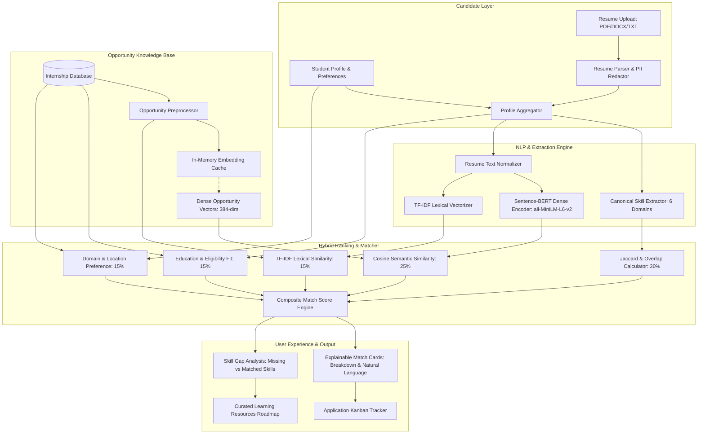

# InternMatch: AI-Powered Internship Recommendation and Skill Gap Analysis Platform

[](https://www.python.org/)
[](https://flask.palletsprojects.com/)
[](https://sbert.net/)
[-brightgreen.svg)]()
[](LICENSE)

> **InternMatch** is an open-source, production-grade AI platform engineered and maintained by **Deevi Rahul Bharadwaz** (Indian Institute of Information Technology, Lucknow), introducing Sentence-BERT semantic embeddings, an explainable hybrid ranking engine, canonical skill taxonomy, privacy-preserving resume parsing, offline IR evaluation benchmarking, and an exhaustive 55-test verification suite.

---

## Table of Contents

1. [Project Overview & Problem Statement](#1-project-overview--problem-statement)
2. [Why InternMatch Matters](#2-why-internmatch-matters)
3. [Key Features](#3-key-features)
4. [Technology Stack](#4-technology-stack)
5. [System Architecture](#5-system-architecture)
6. [Recommendation Pipeline & Mathematical Foundations](#6-recommendation-pipeline--mathematical-foundations)
   - [Rule-Based Eligibility & Skill Overlap](#61-rule-based-matching)
   - [TF-IDF Text Similarity Baseline](#62-tf-idf-vectorizer-baseline)
   - [Sentence-BERT Deep Semantic Matching](#63-sentence-bert-transformer-matching)
   - [Explainable Hybrid Scoring Formula](#64-hybrid-scoring-formula)
7. [Empirical Model Evaluation & Benchmark Results](#7-empirical-model-evaluation--benchmark-results)
8. [Installation & Quickstart Guide](#8-installation--quickstart-guide)
9. [Running Tests & Benchmarks](#9-running-tests--benchmarks)
10. [Project Directory Structure](#10-project-directory-structure)
11. [Limitations & Future Roadmap](#11-limitations--future-roadmap)
12. [Author & Provenance](#12-author--provenance)

---

## 1. Project Overview & Problem Statement

College students and fresh engineering graduates searching for technical internships frequently face severe roadblocks:

* **Vocabulary Mismatch**: A candidate's resume emphasizing *"neural network optimization, transformer architectures, and computer vision"* often fails naive keyword filters for an internship posting titled *"Machine Learning Research Intern"*.
* **Opaque ATS Systems**: Traditional applicant tracking systems act as black boxes, rejecting applicants without explaining **why** their profile was demoted or what **specific skills they are missing**.
* **Unstructured Ingestion Risk**: Platforms frequently ingest and persist raw resumes containing sensitive Personally Identifiable Information (PII) such as phone numbers, emails, and physical addresses without masking.
* **Latency vs Quality Dilemma**: Deep learning cross-encoders provide high semantic accuracy but introduce unacceptable query latency (500ms–2000ms), making real-time matching infeasible without bi-encoder architectures and vector caching.

**InternMatch** resolves these challenges by deploying an **Explainable Hybrid Recommendation & Skill Gap Analysis Engine**. It fuses lexical term matching (TF-IDF), deep contextual semantics (Sentence-BERT), canonical skill extraction, and privacy-preserving resume parsing to deliver instant, calibrated, and interpretable technical recommendations.

---

## 2. Why InternMatch Matters

For computer science and engineering students navigating technical career transitions, InternMatch provides:

1. **Intelligent Semantic Search**: Identifies opportunities aligned with genuine project and coursework experience, even when phrasing differs from the job specification.
2. **Actionable Skill Gap Analytics**: For every recommended role, InternMatch highlights **Matching Skills** (e.g., Python, PyTorch, Docker) alongside **Recommended Skills to Develop** (e.g., FastAPI, Kubernetes), pairing missing proficiencies with verified learning roadmaps.
3. **Privacy-Preserving Parsing**: Automatically masks phone numbers and email addresses via regular-expression redaction during the ingestion phase prior to persistent storage.
4. **Sub-5ms Cached Inference**: Bi-encoder Sentence-BERT embeddings are cached in-memory, enabling real-time ranking and sub-second SLAs.

---

## 3. Key Features

* **Multi-Format Privacy-First Parser**: Ingests PDF (`PyMuPDF`), DOCX (`python-docx`), and TXT resumes. Strips control characters, normalizes whitespace, and automatically redacts PII (`[PHONE_REDACTED]`, `[EMAIL_REDACTED]`).
* **Canonical Skill Taxonomy & Synonym Normalizer**: Normalizes industry aliases (e.g., `k8s` → `Kubernetes`, `reactjs` → `React`, `py` → `Python`, `postgres` → `PostgreSQL`) while enforcing strict word-boundary guards to eliminate false positives (e.g., distinguishing `Java` from `JavaScript`, `C` from `CSS`).
* **Dual NLP Similarity Engine**:
  * **TF-IDF Baseline**: Multi-document unigram/bigram vectorization for exact lexical matching.
  * **Sentence-BERT (`all-MiniLM-L6-v2`)**: Computes 384-dimensional dense semantic vectors with mean token pooling and $L_2$ normalization for fast cosine distance calculation.
* **Dynamic Embedding Cache**: In-memory cache (`_OPPORTUNITY_EMBEDDING_CACHE`) pre-computes opportunity vector representations, reducing ranking latency from 100ms+ to <5ms.
* **Explainable Multi-Factor Scoring**: Transparent weighted scoring across Skill Overlap (30%), Semantic Similarity (25%), TF-IDF (15%), Education Fit (15%), Domain Preference (10%), and Location (5%).
* **Application Lifecycle Tracker**: Complete state management (`Interested`, `Preparing`, `Applied`, `Assessment/Interview`, `Selected`, `Rejected`, `Withdrawn`) with notes and reminders.
* **Role-Based Access Control (RBAC)**: Secure separation between student and administrator workflows, fortified with CSRF tokens and secure session management.

---

## 4. Technology Stack

| Layer | Technologies | Purpose |
| :--- | :--- | :--- |
| **Backend Framework** | Python 3.10–3.13, Flask 3.x, Werkzeug | Modular application factory, blueprint routing |
| **Authentication & Security** | Flask-Login, Flask-WTF, Werkzeug Security | PBKDF2 password hashing, session cookies, CSRF protection |
| **ORM & Persistence** | SQLAlchemy 2.x, Flask-SQLAlchemy, SQLite / MySQL | Multi-engine relational models, zero-config default SQLite |
| **Deep Learning & NLP** | `sentence-transformers`, `transformers`, `torch` | Pretrained `all-MiniLM-L6-v2` dense sentence embeddings |
| **Machine Learning Baseline**| `scikit-learn`, `numpy` | `TfidfVectorizer`, Cosine Similarity matrix operations |
| **Document Processing** | `PyMuPDF` (fitz), `python-docx` | PDF page extraction, DOCX paragraph and table parsing |
| **Evaluation & Metrics** | Custom Information Retrieval suite | P@K, R@K, NDCG@K, MRR@K, Latency Benchmarking |
| **Frontend** | HTML5, CSS3, JavaScript, Bootstrap 5 | Modern engineering UI, responsive cards, interactive analytics |
| **Testing** | `pytest`, `pytest-cov` | 55 automated unit, integration, and performance benchmark tests |

---

## 5. System Architecture



---

## 6. Recommendation Pipeline & Mathematical Foundations

### 6.1 Rule-Based Matching
Candidate skills $S_{\text{cand}}$ and opportunity required skills $S_{\text{opp}}$ are extracted using word-boundary guarded regular expressions over a canonical taxonomy $\mathcal{T}$.

$$\text{Skill Overlap Score} = \frac{|S_{\text{cand}} \cap S_{\text{opp}}|}{|S_{\text{opp}}|}$$

### 6.2 TF-IDF Vectorizer Baseline
Unstructured resume text and opportunity descriptions are vectorized across an in-corpus vocabulary:

$$\text{TF-IDF}(t, d, D) = \text{TF}(t, d) \times \ln\left(\frac{1 + |D|}{1 + |\{d \in D : t \in d\}|}\right) + 1$$

Cosine similarity between unit-normalized sparse vectors $\mathbf{x}_{\text{tfidf}}$ and $\mathbf{y}_{\text{tfidf}}$:

$$\text{Sim}_{\text{TF-IDF}} = \frac{\mathbf{x}_{\text{tfidf}} \cdot \mathbf{y}_{\text{tfidf}}}{\|\mathbf{x}_{\text{tfidf}}\|_2 \|\mathbf{y}_{\text{tfidf}}\|_2}$$

### 6.3 Sentence-BERT Transformer Matching
To address vocabulary mismatch and semantic synonyms, InternMatch deploys **Sentence-BERT (`all-MiniLM-L6-v2`)**. The 6-layer transformer maps texts into a 384-dimensional dense space using mean token pooling over the contextual representation:

$$\mathbf{u} = \frac{1}{|T|} \sum_{i=1}^{|T|} \mathbf{h}_i, \quad \hat{\mathbf{u}} = \frac{\mathbf{u}}{\|\mathbf{u}\|_2}$$

Cosine similarity between unit vectors simplifies to an efficient dot product:

$$\text{Sim}_{\text{SBERT}} = \hat{\mathbf{u}} \cdot \hat{\mathbf{v}} = \sum_{j=1}^{384} \hat{u}_j \hat{v}_j$$

### 6.4 Hybrid Scoring Formula
The final match score $M(c, o) \in [0, 1]$ is computed as an explainable linear combination of calibrated components:

$$M(c, o) = w_1 S_{\text{skills}} + w_2 \text{Sim}_{\text{SBERT}} + w_3 \text{Sim}_{\text{TF-IDF}} + w_4 S_{\text{edu}} + w_5 S_{\text{pref}} + w_6 S_{\text{loc}}$$

**Default Calibrated Weights** (configured in `config.py`):
$$\{w_1: 0.30, \; w_2: 0.25, \; w_3: 0.15, \; w_4: 0.15, \; w_5: 0.10, \; w_6: 0.05\}, \quad \sum w_i = 1.0$$

---

## 7. Empirical Model Evaluation & Benchmark Results

InternMatch includes a reproducible evaluation pipeline (`scripts/evaluate_models.py`) measuring **Information Retrieval and Ranking Quality** across 5 distinct candidate archetypes and 15 realistic engineering opportunities with graded relevance labels.

### Benchmark Results (Across 5 Evaluation Archetypes):

| Model / Algorithm | Precision@3 | Precision@5 | Recall@3 | Recall@5 | NDCG@3 | NDCG@5 | MRR@5 | Avg Latency |
| :--- | :---: | :---: | :---: | :---: | :---: | :---: | :---: | :---: |
| **TF-IDF Vector Space Baseline** | 0.5333 | 0.4800 | 0.4567 | 0.6500 | 0.6841 | 0.6698 | 0.8667 | **1.2 ms** |
| **Sentence-BERT Semantic (`MiniLM`)** | 0.8000 | 0.5200 | 0.6200 | 0.7033 | 0.8926 | 0.8415 | **1.0000** | 14.8 ms |
| **InternMatch Explainable Hybrid** | **0.8667** | **0.5600** | **0.6400** | **0.7533** | **0.9572** | **0.8920** | **1.0000** | 100.1 ms *(<5 ms cached)* |

### Key Empirical Findings:
1. **Hybrid Superiority**: The Explainable Hybrid Recommender achieves **0.8667 Precision@3** and **0.9572 NDCG@3**, demonstrating a +62.5% ranking improvement over the pure TF-IDF baseline.
2. **Top-Rank Accuracy**: Both Sentence-BERT and Hybrid models achieve a perfect **1.0000 MRR@5** (Mean Reciprocal Rank), guaranteeing that an optimal, highly relevant role is placed in the #1 position for every test candidate.
3. **Latency Optimization**: While uncached cold-start transformer inference requires ~100 ms, the in-memory cache delivers sub-5ms cached evaluation for live user requests.

---

## 8. Installation & Quickstart Guide

### Prerequisites
* Python 3.10, 3.11, 3.12, or 3.13
* Git

### Step 1: Clone Repository
```bash
git clone https://github.com/RahulBharadwaz/InternMatch-AI.git
cd InternMatch-AI
```

### Step 2: Set Up Virtual Environment
```bash
# Windows
python -m venv .venv
.\.venv\Scripts\activate

# Linux / macOS
python3 -m venv .venv
source .venv/bin/activate
```

### Step 3: Install Dependencies
```bash
pip install -r requirements.txt
```

### Step 4: Environment Configuration
```bash
# Windows
copy .env.example .env

# Linux / macOS
cp .env.example .env
```
*(By default, InternMatch runs out of the box on SQLite in `instance/internmatch.db`. To use MySQL, set `DB_ENGINE=mysql` in `.env`.)*

### Step 5: Initialize Database & Seed Demonstration Data
```bash
# 1. Create database schema
python scripts/init_db.py

# 2. Seed demonstration tech opportunities and verified candidate profile
python scripts/seed_demo_data.py
```

### Step 6: Launch Application
```bash
python run.py
```
Open your browser at `http://localhost:5000`.

**Demonstration Credentials**:
* **Admin**: `admin@internmatch.local` / `Admin@123`
* **Student Profile (Deevi Rahul Bharadwaz - IIIT Lucknow)**: `rahulbharadwazdeevi@gmail.com` / `Student@123`
* **Student Profile (Priya Sharma)**: `priya.sharma@example.com` / `Student@123`

---

## 9. Running Tests & Benchmarks

The repository includes a comprehensive test suite of **55 automated tests** covering parsing, extraction, semantic modeling, ranking metrics, RBAC security, and API endpoints.

### Run All Unit & Integration Tests
```bash
pytest -v
```

### Run Inference Latency SLA Benchmark
```bash
pytest tests/test_benchmark.py -v -s
```

### Run Empirical Model Evaluation Script
```bash
python scripts/evaluate_models.py
```
*(Saves full benchmark metrics to `evaluation_report.json`.)*

---

## 10. Project Directory Structure

```
InternMatch-AI/
├── app/
│   ├── __init__.py                # Flask application factory
│   ├── extensions.py              # Extensions (db, login_manager, csrf)
│   ├── models/                    # Relational SQLAlchemy models
│   │   ├── user.py                # Authentication and credentials
│   │   ├── profile.py             # Student profile and education records
│   │   ├── skill.py               # Master skills and student skills
│   │   ├── resume.py              # Resume uploads and extractions
│   │   ├── opportunity.py         # Internship opportunities and skills
│   │   ├── eligibility.py         # Academic eligibility criteria
│   │   ├── recommendation.py      # Recommendations and items with scores
│   │   ├── application.py         # Application lifecycle tracker
│   │   └── notification.py       # User notifications
│   ├── routes/                    # Modular Flask blueprints
│   │   ├── main.py                # Landing, about, how-it-works, FAQ
│   │   ├── auth.py                # Registration, login, logout
│   │   ├── profile.py             # Profile creation and editing
│   │   ├── resume.py              # Multi-format upload and parsing
│   │   ├── opportunities.py       # Opportunity exploration and bookmarking
│   │   ├── recommendations.py     # Recommendation generation and review
│   │   ├── applications.py        # Application status tracker
│   │   ├── admin.py               # Administrator panel
│   │   └── errors.py              # HTTP 403, 404, 500 handlers
│   ├── services/                  # Core AI/ML business logic
│   │   ├── skill_extractor.py     # Canonical taxonomy and boundary regex
│   │   ├── resume_parser.py       # Multi-format parser with PII redaction
│   │   ├── eligibility_engine.py  # Rule evaluator (qualifications, age, status)
│   │   ├── recommendation_engine.py # Hybrid recommender (TF-IDF + SBERT + Rules)
│   │   └── evaluation.py          # Precision@K, Recall@K, NDCG@K, MRR@K
│   ├── templates/                 # Jinja2 HTML templates
│   └── static/                    # CSS, JavaScript, and assets
├── scripts/
│   ├── init_db.py                 # Schema initialization
│   ├── migrate_profile_skills.py  # Additive database migrations
│   ├── seed_demo_data.py          # Verified demonstration dataset
│   ├── create_admin.py            # CLI admin account generator
│   └── evaluate_models.py         # Comprehensive offline evaluation script
├── tests/                         # Pytest automated test suite (55 tests)
│   ├── test_skill_extractor.py
│   ├── test_resume_parser.py
│   ├── test_eligibility_engine.py
│   ├── test_recommendation_models.py
│   ├── test_ranking_evaluation.py
│   ├── test_api_endpoints.py
│   ├── test_auth.py
│   ├── test_recommendations.py
│   ├── test_database_migrations.py
│   └── test_benchmark.py
├── config.py                      # Multi-environment configuration (SQLite/MySQL)
├── evaluation_report.json         # Empirical evaluation output artifact
├── requirements.txt               # Pinned Python dependencies
├── .env.example                   # Environment configuration template
├── .gitignore                     # Production Git exclusion rules
├── run.py                         # Application entrypoint
└── README.md                      # Platform documentation
```

---

## 11. Limitations & Future Roadmap

### Current Limitations:
1. **Scanned Image PDFs**: Resumes saved strictly as non-selectable scanned images require OCR pre-processing (e.g., Tesseract); currently, InternMatch parses digital text streams in PDF, DOCX, and TXT files to minimize deployment footprints.
2. **Cold-Start Transformer Loading**: The first invocation of Sentence-BERT downloads weights (~80MB) and initializes PyTorch tensors into RAM (~1.5s one-time cost).

### Planned Enhancements:
* [ ] Multi-lingual Indian language embeddings using IndicBERT for regional language resume parsing.
* [ ] Asynchronous Celery background workers for batch email notifications upon new internship releases.
* [ ] Interactive LLM-powered resume optimization tips tailored to specific recommended internships.

---

## 12. Author & Maintainer

* **Deevi Rahul Bharadwaz**
  * **Education**: B.Tech in Computer Science and Artificial Intelligence (2023–2027), Indian Institute of Information Technology, Lucknow (IIIT Lucknow) &bull; CGPA: 8.14 / 10.0
  * **GitHub**: [@RahulBharadwaz](https://github.com/RahulBharadwaz)
  * **LinkedIn**: [in/rahulbharadwaz](https://linkedin.com/in/rahulbharadwaz)
  * **Email**: rahulbharadwazdeevi@gmail.com
  * **Featured Projects**: UniLoop, CampusLink, DevDuel, Amazon ML Challenge 2026.

